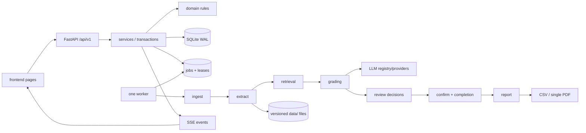

# AI-assisted marker architecture

This document assigns ownership and integration boundaries. Product behavior remains in [DEV-GUIDE.md](DEV-GUIDE.md); contract detail remains in [openapi.yaml](../contracts/openapi.yaml).

## System and flow

Main data flow: upload → safe manifest/fix files → extract → grade → open/claim → review → atomic confirm/completion → report → export. Dry run enqueues the same pipeline for three resolved submissions. FakeLLM replaces only the model-provider boundary.

## Directory ownership

| Path | Belongs here | Must not live here | Lifecycle |
|---|---|---|---|
| `prototype/` | Frozen HTML/JS baseline and generated baseline screenshots | Runtime imports, fixes, mutable demo state | Source-controlled; frozen |
| `frontend/` | Working pages, browser client, mock adapter, UI checklist | Provider keys, SQL, direct provider URLs | Source-controlled |
| `backend/` | Python app, migration source, module tests | Uploads, reports, fixture truth | Source-controlled |
| `contracts/` | OpenAPI, stable errors, LLM JSON Schemas | Implementations or secrets | Source-controlled |
| `fixtures/demo/` | One deterministic cross-page dataset and FakeLLM recordings | Real student work or keys | Source-controlled/generated deterministically |
| `docs/` | Review, this map and decision records | Duplicate endpoint implementation detail | Source-controlled |
| `tests/` | Cross-cutting architecture, e2e and visual tests | Module unit tests | Source-controlled; outputs ignored |
| `eval/` | Runner/metric skeleton and dataset interface | Private golden submissions | Source-controlled; datasets ignored |
| `scripts/` | Task, fixture, seed and validation entrypoints | Business rules | Source-controlled |
| `data/` | DB, uploads, extracted versions, index, reports, exports, cache, safe logs | Source code or fixtures | Runtime-generated; ignored |

Runtime partitions are created only by `config.py`: `db/`, `uploads/tmp/`, `rubrics/source/`, `files/`, `extracted/`, `index/`, `reports/`, `exports/`, `cache/`, and `logs/`. Paths are constructed from IDs/hashes, never user filenames.

## Backend package rules

| Package | Belongs | Must not | Runtime? |
|---|---|---|---|
| `api/` | HTTP/SSE validation and translation | SQL writes, grading logic | Source |
| `services/` | Use cases, transactions, lifecycle coordination | Provider SDK payloads, UI rendering | Source |
| `domain/` | Pure states, completion, bands and IDs | FastAPI, SQLAlchemy, filesystem, network | Source |
| `db/` | mappings, sessions, repositories, migration metadata | Workflow decisions | Source; DB in `data/` |
| `llm/` | protocol, registry, providers, JSON I/O, rate/usage/cache boundaries | Rubric/review business decisions | Source; cache/usage runtime |
| `rubric/` | parse/validate boundary | Batch lifecycle | Source |
| `ingest/` | upload safety, SID, archive and dedupe boundary | Text extraction or grading | Source |
| `extract/` | canonical immutable text/offset versions | Rubric scores | Source; output runtime |
| `retrieval/` | full/retrieved context construction | Provider calls or writes to reviews | Source; index runtime |
| `grading/` | prompts, grade orchestration, quote verification | Final tutor decisions | Source |
| `report/` | audience projections and HTML/PDF render | Changing marks | Source; output runtime |
| `jobs/` | enqueue/lease/heartbeat/retry/dispatch | Domain logic hidden in handlers | Source; job rows runtime |
| `analytics/` | read projections, results and CSV | Writes to owned aggregates | Source |
| `events/` | transient event fan-out to SSE | Durable truth | Source/runtime memory |
| `security/` | secret storage, guards, flags and redaction | Provider selection policy | Source |

## Module responsibility matrix

| Module | Owned dirs | Public interface | Inputs → outputs | Allowed deps | Owns data | Not responsible for | Extension points | Done when |
|---|---|---|---|---|---|---|---|---|
| API | `app/api` | OpenAPI operations | HTTP ↔ service DTOs | services, deps, events | none | transactions/SQL | new resource router | every contract operation has error tests |
| Services | `app/services` | one Protocol/use-case class per owner | DTO + actor → committed result | domain, repositories, queue enqueue, events | transactions | provider/file algorithms | alternate repository/queue | state/audit/idempotency integration tests pass |
| Domain | `app/domain` | enums and pure functions | values → decisions | standard library only | rules | I/O | new policy functions | exhaustive transition/completion tests pass |
| DB | `app/db`, `alembic` | sessions/repositories | aggregates ↔ rows | domain types, SQLAlchemy | durable rows | workflow | SQLite/Postgres repository | migration round-trip and repository tests pass |
| LLM | `app/llm` | `LLM`, registry, JSON I/O | prompt → validated response | config, HTTP client | calls/cache | grading policy | provider adapters | fake + provider contract tests pass |
| Rubric | `app/rubric` | `parse`, `validate`; rubric service writes | source → versioned rubric | LLM, domain, repository | rubrics/versions | batches | parser strategies | deterministic validation and fixture cases pass |
| Ingest | `app/ingest` | `inspect_upload` | bytes → safe manifest | security, submission service | immutable original files via service | extraction | archive/SID detectors | hostile archive/dedupe tests pass |
| Extract | `app/extract` | `extract` | file ref → canonical vN document | ingest public types | extracted versions | grading | PDF/DOCX/OCR adapters | offsets and immutability tests pass |
| Retrieval | `app/retrieval` | `context_for` | document + criterion → chunks | extract public types | index artifacts | scores | full/context/index strategy | recall fixture tests pass |
| Grading | `app/grading` | `grade` | context + snapshot → AI result/evidence | retrieval, LLM, domain | AI results/evidence | final marks | prompts/verifiers | quote/schema/golden tests pass |
| Review | `review_service` | open/save/claim/confirm | AI result + edits → decision | domain, repositories, events | reviews | AI generation | claim policy | race, lock and atomic-completion tests pass |
| Report | `app/report` | HTML/PDF render | confirmed marks → audience report | review reads, domain | report artifacts | changing marks | render engines | student/internal snapshots pass |
| Jobs | `app/jobs` | queue/worker/job payloads | job → handler outcome | services, processing modules | jobs | owner writes bypass | queue backend | restart/retry/heartbeat tests pass |
| Analytics | `app/analytics` | summaries/results/export | records → projections | read repositories, domain | none | source writes | projections | all metrics reconcile to rows |
| Events | `app/events` | publish/subscribe | committed change → SSE event | standard library | none | persistence | broker adapter | reconnect/gap tests pass |
| Security | `app/security` | secret/upload/redaction interfaces | sensitive input → safe value | config/standard crypto libs | encrypted settings policy | grading | key-store/redactors | no-secret/no-PII tests pass |

## Integration rules

- External API is `/api/v1`; incompatible changes require a new version. OpenAPI is authoritative.
- Public names are exported from module `__init__.py` or `interfaces.py`; underscore names and `_internal/` are private.
- Shared enums/value types live only in `domain/`; wire schemas live only in `contracts/`.
- Errors use `{error:{code,message,details}}` and `contracts/errors.yaml`. Do not leak provider bodies, paths or secrets.
- Configuration enters through `config.py`; no module reads ad-hoc environment variables.
- API handlers call services. Jobs call services/processing modules. Provider network calls exist only in `llm/`. Browser backend URLs exist only in `frontend/js/api.js`.
- Unit tests mirror packages; route/fixture tests are contract tests; ownership rules are AST-tested; critical flows have Playwright tests.

## Development plan

1. **M0 skeleton (current):** contract, migration, seed, health, queue/worker, FakeLLM, confirm/completion, static UI and proof wiring.
2. **M1 rubric:** rubric developer owns `rubric/` + rubric service; frontend developer wires setup/library. Done when pasted text round-trips through DB with deterministic validation.
3. **M2 single file:** ingest/extract developers work in parallel after public types settle; grading developer uses FakeLLM; review/report developer uses recorded results. Done when the local-fake flow uses no shared-content fallback for its uploaded file.
4. **M3 multi-file:** ingest ZIP/SID/dedupe, jobs/SSE/retry and status UI can proceed in parallel. Done when a hostile-case 50-file fixture finishes with correct queue ordering.
5. **M4 quality:** retrieval, confidence, usage/cost and evaluation proceed in parallel behind existing interfaces. Done when golden metrics are reproducible.
6. **M5 finish:** analytics, exports, finalise/reopen audit and all page state wiring. Done when the scripted demo has no stub response except explicitly post-MVP endpoints.

The current typed processing packages are skeletons; their `Done when` criteria are handoff contracts, not claims of implementation.

