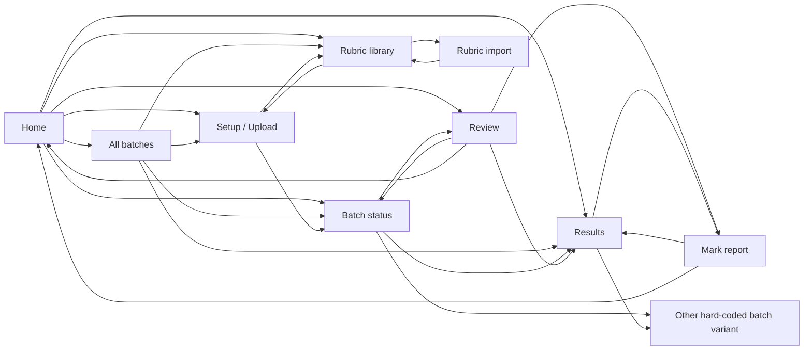
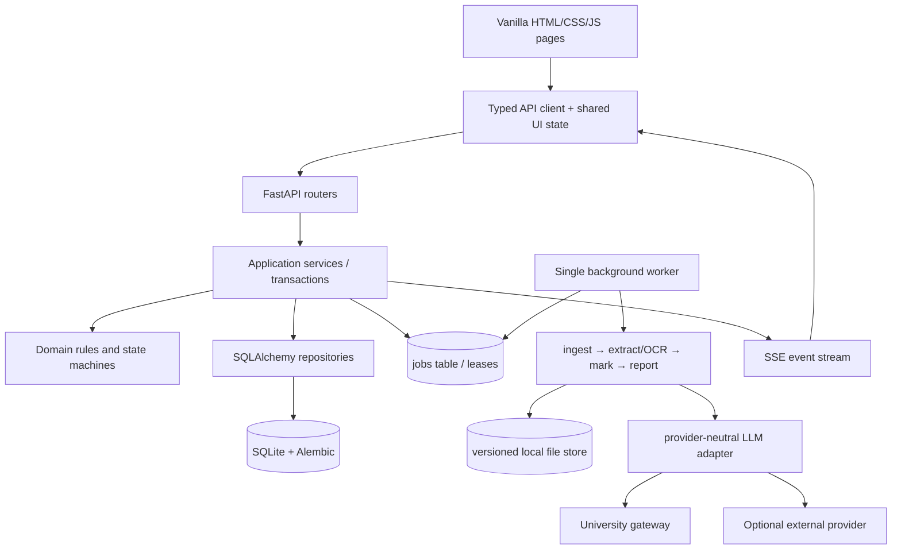

# AI-assisted marker — Phase 1 architecture review

Date: 18 October 2026  
Evidence reviewed: all nine files in `prototype/`, `prototype/account-menu.js`, `prototype/rubric-library.js`, `prototype/README.md`, and `docs/DEV-GUIDE.md` sections S0–S16 and G1–G17.  
Scope: review only. No prototype or implementation code was changed.

## 1. Executive assessment

The prototype establishes a coherent visual language and a credible happy-path workflow: choose a rubric, ingest submissions, watch processing, review criterion-level evidence, and publish results. The implementation guide is also unusually specific about scope, lifecycle, persistence, APIs, and operational constraints. Together they are a strong baseline.

The primary pre-implementation risk is data and lifecycle coherence. Several pages use incompatible versions of the same batch, links discard the selected batch or submission, and the review queue models 48 submissions while its breadcrumb identifies the 1,247-submission ASGN2 batch. The prototype also makes non-MVP Canvas and direct-browser AI-provider features look operational, while the documented MVP requires a local FastAPI boundary and server-side secrets.

Recommended approach: retain the HTML/CSS visual baseline, introduce stable route parameters and a fixture contract first, then replace page-local arrays and `localStorage` with one API client. Persist one batch lifecycle state and derive the counters shown in the UI. Use SQLite as the system of record and a database-backed job queue serviced by one worker process for the local MVP.

### Confirmed requirements

- Local-first, single-user MVP; ZIP/PDF/DOCX ingestion is in scope, while live Canvas integration is not.
- FastAPI, SQLite, Alembic, SQLAlchemy, Pydantic settings, provider adapters, background jobs, SSE progress, pytest, and Playwright.
- Rubrics are versioned snapshots; historical marks must not change when a library rubric changes.
- Evidence offsets refer to an immutable extracted-document version.
- Criterion edits autosave; confirmation and batch-completion evaluation are atomic.
- A batch completes only when `confirmed == total - excluded` and no unresolved failure remains.
- Finalisation locks edits; reopening requires a reason and returns the batch to an editable state.
- UI visuals should remain close to the prototype, with explicit loading, empty, partial, error, retry, permission, and locked states.

### Working assumptions requiring approval

- The existing `Backend/` and `test/` directories may be renamed to `backend/` and `tests/`.
- “Single user” means no authentication in the MVP, but persisted records still carry a seeded `user_id`/`marker_id` so ownership semantics are not hard-coded into presentation code.
- The active provider defaults to the university-managed endpoint; external providers require an explicit per-batch disclosure acknowledgement.
- Quiz 3 should start **finalised** for visual parity with the current results/report pages, despite the Phase 2 shorthand calling it “completed.”
- Demo data will be deterministic and internally consistent, even where that changes prototype counts.

## 2. Page-to-workflow map

<details>
<summary>All pages, purpose, transitions, and data dependencies</summary>

| Page | Intended workflow role | Actual outgoing transitions | Data currently used | Required backend source |
|---|---|---|---|---|
| `00-home.html` | Tutor dashboard and work entry point | Setup, ASGN2 status/review, ASGN1 status, Quiz 3 results, batches, rubric detail | Page-local batch/KPI arrays plus shared local rubrics | `/api/me/summary`, `/api/me/queue`, active `/api/batches`, rubric summaries |
| `01-upload.html` | Create draft batch; choose rubric and submissions; start marking | Rubric library with return context; ASGN2 status after start | Local rubric; hard-coded Canvas assignments; simulated file scan and parse | Draft batch, upload manifest, SID/duplicate corrections, rubric snapshot, start job |
| `01a-rubric-import.html` | Import, validate, edit, export, and save a rubric | Rubric library/detail | Three embedded rubric variants; hard-coded Canvas list | Parse/parse-file, rubric CRUD; Canvas import hidden or explicitly unavailable in MVP |
| `02-batch-status.html` | Monitor processing and select review work | Review, ASGN1 variant, Quiz 3 results | Two hard-coded batch variants and six sample rows each | Batch detail, paginated submissions, SSE events, retry/exclude actions |
| `03b-review-split.html` | Review document evidence and criterion marks | Previous/status, next queue item, waiting/complete cards, results/report/home | One essay, one score set, synthetic 48-item queue | Review bundle, immutable document, autosave, claim, confirm, next queue item |
| `04-batch-complete.html` | Inspect completed/finalised results and export/finalise/reopen | Report, ASGN1 status; export/reopen controls are inert | Fixed Quiz 3 aggregate and six rows | Results, paginated submissions, CSV/PDF exports, finalise/reopen |
| `05-mark-report.html` | Printable per-student mark report | Results/home | Fixed Quiz 3 SID50102 report | Submission report and server-rendered PDF |
| `06-rubrics.html` | Search, inspect, edit, delete, and select rubric | Import; setup via URL-embedded rubric | Shared `dryrun.library.v1` localStorage | Rubric CRUD, usage/version metadata |
| `07-batches.html` | Browse/search/filter all batches | Setup, status/result pages, rubric detail | Eight hard-coded rows | `/api/batches` filters and pagination |

</details>

### Navigation implemented by the prototype



The arrows exist, but most do not preserve entity identity. Several batch and submission links always open the same fixed page content.

## 3. UI state coverage

Legend: ✓ meaningful state; △ partial/simulated; — absent. “Empty” includes no-result search where noted.

| Page | Loading | Empty | Partial/progress | Error | Retry | Permission | Locked/read-only |
|---|---:|---:|---:|---:|---:|---:|---:|
| Home | — | — | △ active batch progress | — | — | — | — |
| Setup/upload | △ parse timer | ✓ missing inputs | △ scan warnings | △ parse validation only | — | — | — |
| Rubric import | — | — | △ consistency checks | △ content validation only | — | △ “no access” sample | — |
| Batch status | — | — | ✓ processing rows and ETA | — | — | — | — |
| Review | — | ✓ waiting queue card | ✓ AI still processing | — | — | — | △ confirmation styling only |
| Results | — | — | — | — | — | — | ✓ fixed finalised view |
| Mark report | — | — | — | — | — | — | ✓ released/read-only presentation |
| Rubric library | — | ✓ search result | — | — | — | △ delete blocked when “in use” | — |
| All batches | — | ✓ search result | ✓ per-row progress | — | — | — | — |

Required before end-to-end completion: skeleton/loading states, transport and job failures, actionable retries, upload cancellation/removal, failed-queue terminal state, stale-edit/claim conflict, finalisation precondition errors, and a deliberate permission/not-supported treatment for Canvas.

## 4. Findings

| ID | Category / severity | Evidence | Expected | Actual / impact | Proposed resolution |
|---|---|---|---|---|---|
| F01 | Inconsistent / critical | ASGN2 home/status/review | One batch identity and one set of counts | ASGN2 is 1,247 items on home/status but the review queue is 48. Completion can lead to an unrelated result. | Route every page by stable IDs and use one fixture/API source. |
| F02 | Inconsistent / critical | Review completion → results/report | Preserve current batch/submission | ASGN2 completion opens fixed Quiz 3/SID50102 content. | Resolve destination from confirm response; dynamic result/report routes. |
| F03 | Security / critical | `account-menu.js` | Secrets held server-side | Raw provider and Canvas credentials are stored in browser localStorage; provider APIs are called from the browser. | Move settings and provider calls behind FastAPI; never return stored secrets. |
| F04 | Scope / high | Setup/import/account menu | Canvas clearly out of MVP | Canvas selectors, test buttons, and release labels look operational; several are inert. | Hide behind `canvas_enabled=false` or label “Not available in local MVP.” |
| F05 | Misleading / high | Setup/import | Real validation and async jobs | Parsing, file scanning, and start actions are timers or fixed values; arbitrary ZIP can become “1,247 files.” | Replace all with API-driven jobs and explicit demo fixture actions. |
| F06 | Missing / high | Batch status | Usable filters, failure recovery, live progress | Filter pills are inert; there is no failed filter, retry, exclude, or SSE handling. | Implement URL-backed filters, action menus, reconnecting SSE, and polling fallback. |
| F07 | Missing / critical | Review | Validated autosave and atomic confirmation | Scores are not bounded, comments can be blank, nothing persists, and confirmation has no conflict handling. | Client validation plus versioned PATCH; transactional confirm; disable until valid/saved. |
| F08 | Missing / high | Results | Completed editable state and working lifecycle controls | Only a fixed finalised view exists; CSV and reopen controls are dead links. | Render completed/finalised variants from state and wire export/finalise/reopen. |
| F09 | Inconsistent / high | Status/results tables | Selected row opens that entity | Many different rows open the same review/report. | Put `batch_id`/`submission_id` in every link and load by route. |
| F10 | Known mismatch / medium | Home vs S7 | Current tutor metrics across active batches | Dashboard values are mostly ASGN2-only and cannot be reconciled with ASGN1. | Define ownership and compute summary from canonical records. |
| F11 | Ambiguous / high | ASGN2 counters | Mutually reconcilable state counts | `ready=792`, confidence totals `836`, `processing=411`, and `needs OCR=11` have unclear overlap. | Distinguish disjoint lifecycle counts from subset flags such as low confidence. |
| F12 | Documentation drift / medium | S13 vs current review | Difference register reflects current prototype | S13 says review only loops, but the page now has waiting and completion cards. | Update S13 during Phase 2 documentation work. |
| F13 | Missing / high | All pages | Explicit required UI states | Loading, transport failure, retry, claim conflict, and permission states are mostly absent. | Add a shared state component and per-page state checklist. |
| F14 | Known gap / high | Setup vs S13/G8 | Dry run, cost, correction, duplicate handling | No batch naming/term, dry run, cost confirmation, SID fix, duplicate selection, or skipped-file remediation. | Add a staged upload manifest before “Start full batch.” |
| F15 | Data integrity / high | Rubric library | Immutable versioned snapshots | Mutable local objects include hand-maintained `usedBy`; edits can blur historical use. | Version rubric definitions and copy a snapshot/version ID into each batch. |
| F16 | Privacy / high | Report and AI settings | Defined internal/student report audiences and disclosure | One report mixes evidence and commentary; external-provider disclosure is absent. | Add `audience=internal|student`; require disclosure acknowledgement before upload. |
| F17 | Repository / low | Root folders | `backend/`, `frontend/`, `tests/` | Existing empty folders are `Backend/` and `test/`, which is unsafe across case-sensitive environments. | Rename before scaffolding. |
| F18 | Contract gap / medium | B6/S12 | Every visible export has an API | Per-student PDF exists, but no batch PDF bundle endpoint; results row filtering/pagination is underspecified. | Add an async batch-report export and formalise result list paging/filtering. |
| F19 | State ambiguity / high | S8/S10 | One deterministic batch lifecycle | Guide says processing and review can coexist, but a single enum cannot be both; display rules do not fully define persistence. | Persist one lifecycle state; show simultaneous work through derived counters. |
| F20 | Future/over-specified / medium | G8 vs S10/S12 | Features align across guide, state model, and API | Pause/cancel is recommended in G8 but has no lifecycle state or endpoint. Embeddings/FTS are optional before their need is demonstrated. | Defer pause/cancel, embeddings, and FTS unless accepted into MVP scope. |

### What is already aligned

- Route concepts, terminology, visual hierarchy, rubric structure, criterion evidence, confidence flags, review split view, and final report structure substantially match the guide.
- ASGN1 counts reconcile (`312 confirmed + 28 remaining = 340`), as do Quiz 3 distribution totals and the displayed report score breakdown.
- The review page already demonstrates hover/click evidence linking, resizable/collapsible document view, waiting behavior, and completion behavior that can be retained as presentation logic.

## 5. Demo-data inventory and normalization

<details>
<summary>Prototype data that must become fixtures</summary>

- Identity/settings: J. Alvarez, M. Okafor, Semester 2 2026, university Canvas URL, provider/model choices.
- Rubrics: six library rubrics with criteria, weights, performance bands, source labels, use references, and timestamps.
- Batches: ASGN2 Critical Essay, ASGN1 Literature Review, Quiz 3 Short Answer, ASGN3 Final Project Report, Quiz 2, Group Presentation, Quiz 1, Reflective Journal.
- Setup samples: three Canvas-looking assignments, `ASGN2_batch_2026S2.zip`, scanned-file counts, and the Lab Report rubric parse warning.
- Import samples: Final Project Report rubric, Progress Report, inaccessible assignment, JSON upload metadata, flattened-text variant, and deliberate consistency warnings.
- Batch rows: twelve displayed ASGN2/ASGN1 submissions including score, confidence, status, file type, marker, and scanned flag.
- Review fixture: SID40219, six-page/2,180-word essay, eight evidence anchors, four criteria, AI total 80, confidence, rationale, and comments.
- Results fixture: Quiz 3 aggregates, five grade bands, three criterion summaries, six submission rows, adjustment deltas, and release metadata.
- Report fixture: SID50102, final 68/100, criterion comments/evidence, AI delta, summary, strengths, improvement, and next step.

</details>

### Required normalization

1. ASGN2 should use one disjoint partition: `825 ready + 411 processing + 11 needs_manual = 1,247`; `44 low_confidence` is a subset of ready and `836 processed = 825 ready + 11 needs_manual`. This corrects the displayed `ready=792` inconsistency.
2. ASGN1 remains `312 confirmed + 28 ready = 340`; its six low-confidence items are a subset of ready.
3. The ASGN2 review queue must use ASGN2 counts and IDs, not the embedded 48-item mini-batch. The `single`, `last`, and `wait` prototype modes should become test fixtures, not production query parameters.
4. Quiz 3’s 1,198 distribution total and 68-point SID50102 report already reconcile. Seed it as finalised if preserving the current locked/released page; otherwise add a distinct completed state.
5. Every visible table row needs a real matching detail/report fixture. Reusing one essay/report for different students should only occur in a clearly labelled UI test fixture.
6. Freeze timestamps and relative-date labels in tests. API timestamps should be UTC ISO 8601; UI display uses `Australia/Sydney`.
7. Generate lightweight deterministic records for full counts so dashboard metrics are database-derived; do not store aggregate numbers that disagree with the underlying rows.

## 6. Proposed API contract

### Conventions and shared shapes

- JSON uses `snake_case`; IDs are opaque strings; timestamps are UTC ISO 8601 strings or `null` where stated.
- Pagination is `{items: T[], page: integer, page_size: integer, total: integer}`.
- Error response is always `{"error":{"code":string,"message":string,"details":object|null,"request_id":string}}`.
- Mutations that can race accept `version`; a stale mutation returns HTTP 409 `version_conflict`.
- `BatchStatus = "draft" | "processing" | "in_review" | "completed" | "finalised" | "failed_all"`.
- `SubmissionStatus = "uploaded" | "extracting" | "needs_ocr" | "ocr_running" | "queued" | "marking" | "ai_done" | "in_review" | "confirmed" | "failed" | "excluded"`.
- `Confidence = "high" | "medium" | "low" | "none"`.
- `Counts = {"total":integer,"processed":integer,"ready":integer,"low_confidence":integer,"needs_manual":integer,"processing":integer,"confirmed":integer,"adjusted":integer,"failed":integer,"excluded":integer}`.
- `RubricSummary = {"id":string,"version":integer,"title":string,"source":string,"criteria_count":integer,"total_weight":number,"used_by_count":integer,"updated_at":string}`.
- `CriterionDefinition = {"id":string,"name":string,"weight":number,"description":string,"levels":[{"id":string,"label":string,"min_score":number,"max_score":number,"description":string}]}`.
- `Rubric = {"id":string,"version":integer,"title":string,"source":string,"criteria":CriterionDefinition[],"created_at":string,"updated_at":string}`.
- `BatchSummary = {"id":string,"name":string,"unit":string|null,"term":{"id":string,"label":string},"due_at":string|null,"status":BatchStatus,"rubric":RubricSummary|null,"counts":Counts,"eta_seconds":integer|null,"created_at":string,"started_at":string|null,"completed_at":string|null,"finalised_at":string|null}`.
- `SubmissionRow = {"id":string,"batch_id":string,"sid":string|null,"filename":string,"status":SubmissionStatus,"ai_total":number|null,"final_total":number|null,"confidence":Confidence|null,"marker":{"id":string,"name":string}|null,"flags":string[],"error":{"code":string,"message":string}|null,"updated_at":string,"version":integer}`.
- Binary responses below return the stated content type and `Content-Disposition`; they are not JSON envelopes.

### Endpoint inventory from S12

| Method and path | Exact request | Success response | Prototype consumer / note |
|---|---|---|---|
| `GET /api/me/summary` | none | `{"ready_for_review":{"count":integer,"by_batch":[{"batch_id":string,"batch_name":string,"count":integer}],"next_submission_id":string|null},"low_confidence":{"count":integer,"by_batch":[...]},"needs_manual":{"count":integer,"by_batch":[...]},"confirmed_this_week":{"count":integer,"average_seconds":number|null,"week_started_at":string}}` | Home KPIs; current tutor only. |
| `GET /api/me/queue?limit=5` | query `limit: 1..50` | `{"items":[{"submission_id":string,"sid":string|null,"batch_id":string,"batch_name":string,"reason":"ready"|"low_confidence"|"needs_manual","criterion_id":string|null,"criterion_name":string|null,"confidence":Confidence|null,"ai_total":number|null}],"limit":integer}` | Home “Up next.” |
| `GET /api/batches?active=&term=&status=&q=` | optional booleans/strings plus `page`, `page_size` | paginated `BatchSummary` | Home and all batches. `active=true` excludes finalised. |
| `POST /api/batches` | `{"name":string,"unit":string|null,"term_id":string,"due_at":string|null,"rubric_id":string|null,"rubric_version":integer|null}` | `{"batch":BatchSummary}` with `status="draft"` | Setup creation. |
| `GET /api/batches/:id` | none | `{"batch":BatchSummary,"rubric_snapshot":Rubric|null,"previous_batch":{"id":string,"name":string}|null,"next_batch":{"id":string,"name":string}|null}` | Setup/status/header. |
| `GET /api/batches/:id/submissions?filter=&page=` | `filter="all"|"ready"|"low_confidence"|"needs_manual"|"processing"|"failed"|"confirmed"|"adjusted"`, page params | paginated `SubmissionRow` plus top-level `{"filter_counts":Counts}` | Status/results tables. |
| `GET /api/batches/:id/events` | `Accept: text/event-stream`; optional `Last-Event-ID` | SSE events: `batch_progress` data `{"batch_id":string,"status":BatchStatus,"counts":Counts,"eta_seconds":integer|null,"updated_at":string}`; `submission_updated` data `SubmissionRow`; `review_ready` data `{"submission_id":string,"sid":string|null}`; heartbeat comment | Status/review. Reconnect then refresh batch if event gap occurs. |
| `POST /api/batches/:id/files` | `multipart/form-data`, repeated `files`, max-size policy | `{"files":[{"id":string,"name":string,"size":integer,"mime_type":string,"sha256":string,"sid_guess":string|null,"pages":integer|null,"has_text_layer":boolean|null,"status":"accepted"|"duplicate"|"unsupported"|"too_large","duplicate_of":string|null,"message":string|null}],"summary":{"accepted":integer,"duplicates":integer,"skipped":integer,"needs_sid":integer,"likely_scanned":integer}}` | Setup upload manifest. |
| `DELETE /api/batches/:id/files/:fid` | none | `{"deleted":true,"file_id":string}` | Remove draft file only; 409 after start. |
| `PATCH /api/batches/:id/submissions/:sid` | `{"student_id":string|null,"excluded":boolean|null,"excluded_reason":string|null,"selected_file_id":string|null,"version":integer}` | `{"submission":SubmissionRow}` | Fix SID, exclude, resolve duplicates before/after processing where allowed. |
| `POST /api/batches/:id/start?sample=3` | query `sample: integer|null`; body `{"provider":string,"model":string,"concurrency":integer,"external_processing_acknowledged":boolean,"estimated_cost_acknowledged":boolean}` | `{"batch_id":string,"status":"processing","job_id":string,"sample_size":integer|null,"queued":integer,"counts":Counts}` | Dry run or full start; 422 if manifest unresolved. |
| `POST /api/submissions/:id/retry` | `{"stage":"extract"|"ocr"|"mark","reason":string|null,"version":integer}` | `{"submission_id":string,"status":"queued","job_id":string,"attempt":integer,"version":integer}` | Failed-row recovery. |
| `GET /api/submissions/:id/review` | none | `{"submission":SubmissionRow,"batch":{"id":string,"name":string,"status":BatchStatus},"document":{"id":string,"version":integer,"page_count":integer,"word_count":integer,"content_url":string,"mime_type":string},"rubric":{"id":string,"version":integer,"title":string,"criteria":[{"definition":CriterionDefinition,"ai_score":number|null,"score":number|null,"confidence":Confidence,"status":"ai_suggested"|"edited"|"confirmed","rationale":string,"comment":string,"evidence_ids":string[],"version":integer}]},"evidence":[{"id":string,"criterion_id":string,"document_version":integer,"page":integer|null,"start_offset":integer,"end_offset":integer,"quote":string,"label":"primary"|"supporting"}],"can_edit":boolean,"claim":{"marker_id":string,"marker_name":string,"expires_at":string}|null}` | Review page. Content URL may point to the next endpoint. |
| `GET /api/submissions/:id/file` | none | Original or normalized document bytes; `ETag` includes document version | Review document/download; authentication omitted only for local MVP. |
| `PATCH /api/submissions/:id/criteria/:cid` | `{"score":number|null,"comment":string,"version":integer}` | `{"criterion_id":string,"score":number|null,"comment":string,"status":"edited","version":integer,"saved_at":string,"submission_total":number|null}` | Debounced autosave. 423 if finalised; 409 if stale/claimed. |
| `POST /api/submissions/:id/confirm` | `{"version":integer}` | `{"submission_id":string,"status":"confirmed","confirmed_at":string,"next_id":string|null,"batch_status":BatchStatus,"remaining":{"ready":integer,"processing":integer,"failed":integer}}` | Atomic confirmation and completion check. Idempotent repeat returns same logical result. |
| `POST /api/submissions/:id/claim` | `{"version":integer,"ttl_seconds":integer}` | `{"submission_id":string,"claimed_by":{"id":string,"name":string},"claimed_until":string,"version":integer}` | Optional concurrency guard; 409 if another live claim exists. |
| `GET /api/batches/:id/queue/next?after=` | optional `after: submission_id` | `{"next_id":string|null,"remaining":{"ready":integer,"processing":integer,"failed":integer}}` | Next/wait/failed/complete review cards. |
| `GET /api/batches/:id/results` | optional `filter`, `page`, `page_size` | `{"batch":BatchSummary,"locked":boolean,"released_at":string|null,"released_to":string|null,"summary":{"average_final":number|null,"average_ai":number|null,"adjusted_count":integer,"adjusted_percent":number,"comments_count":integer,"marker_count":integer},"distribution":[{"band":string,"min_score":number,"max_score":number,"count":integer}],"criteria":[{"criterion_id":string,"name":string,"max_score":number,"average_ai":number|null,"average_final":number|null,"adjusted_count":integer}],"submissions":{"items":SubmissionRow[],"page":integer,"page_size":integer,"total":integer}}` | Results page. Use `grade_changed`, not mixed “band changed.” |
| `GET /api/batches/:id/export.csv` | optional `filter` | `text/csv` bytes | Working CSV download; available completed/finalised. |
| `POST /api/batches/:id/finalise` | `{"version":integer}` | `{"batch_id":string,"status":"finalised","locked":true,"finalised_at":string,"version":integer}` | Requires completed and no unresolved failures. |
| `POST /api/batches/:id/reopen` | `{"reason":string,"version":integer}` | `{"batch_id":string,"status":"completed","locked":false,"reopened_at":string,"version":integer}` | Reason required and audited. |
| `GET /api/submissions/:id/report` | optional `audience=internal|student` | `{"submission":{"id":string,"sid":string|null,"filename":string},"batch":{"id":string,"name":string,"unit":string|null},"status":"confirmed","locked":boolean,"audience":"internal"|"student","final_total":number,"band":string,"ai_total":number|null,"adjustment":number|null,"confirmed_at":string,"marker":{"id":string,"name":string},"summary":string,"strengths":string[],"improvements":string[],"next_steps":string[],"criteria":[{"criterion_id":string,"name":string,"score":number,"max_score":number,"comment":string,"ai_score":number|null,"evidence":[{"page":integer|null,"quote":string}]}]}` | Dynamic report. Student audience omits internal rationale/confidence. |
| `GET /api/submissions/:id/report.pdf` | optional `audience=internal|student` | `application/pdf` bytes | Stable printable PDF generated server-side. |
| `GET /api/rubrics` | optional `q`, `source`, `page`, `page_size` | paginated `RubricSummary` | Rubric library. |
| `POST /api/rubrics` | `{"title":string,"source":string,"criteria":CriterionDefinition[]}` | `{"rubric":Rubric}`; HTTP 201 | Save imported/new rubric version 1. |
| `GET /api/rubrics/:id` | optional `version` | `{"rubric":Rubric,"used_by":[{"batch_id":string,"batch_name":string,"rubric_version":integer}]}` | Drawer/detail and setup. |
| `PUT /api/rubrics/:id` | `{"title":string,"source":string,"criteria":CriterionDefinition[],"version":integer}` | `{"rubric":Rubric}` with a new immutable version | Editing never mutates batch snapshots. |
| `DELETE /api/rubrics/:id` | `{"version":integer}` | `{"deleted":true,"rubric_id":string}` | 409 `rubric_in_use` when referenced. |
| `POST /api/rubrics/parse` | `{"text":string,"source_name":string|null}` | `{"rubric":Rubric,"warnings":[{"code":string,"message":string,"criterion_id":string|null}],"parser":"deterministic"|"ai"}` | Pasted-text import; response rubric has provisional ID/version. |
| `POST /api/rubrics/parse-file` | multipart `file`; optional form `use_ai:boolean` | same shape as `/parse` plus `{"file":{"name":string,"size":integer,"mime_type":string}}` | PDF/DOCX/image import; OCR may return HTTP 202 with `job_id` and poll URL. |
| `GET /api/settings/ai` | none | `{"provider":string,"model":string,"base_url":string|null,"uses_university_gateway":boolean,"has_api_key":boolean,"available_models":string[]}` | Account settings; secret is never returned. |
| `PUT /api/settings/ai` | `{"provider":string,"model":string,"base_url":string|null,"api_key":string|null,"uses_university_gateway":boolean}` | same safe shape as GET | Empty/null key preserves existing secret unless `clear_api_key=true` is added. |
| `GET /api/settings/canvas` | none | `{"enabled":boolean,"base_url":string|null,"has_token":boolean}` | MVP returns `enabled=false`. |
| `PUT /api/settings/canvas` | `{"base_url":string|null,"token":string|null,"enabled":boolean}` | same safe shape as GET | Prefer 501 `feature_not_enabled` until Canvas enters scope. |
| `POST /api/settings/ai/test` | `{"provider":string|null,"model":string|null}` | `{"ok":boolean,"latency_ms":integer|null,"model":string|null,"message":string}` | Server-side connectivity test without exposing credentials. |

### Contract gaps to add or explicitly defer

- `POST /api/batches/:id/report-export` → `{"job_id":string,"status":"queued"}` and `GET /api/exports/:job_id` → `{"status":"queued"|"running"|"complete"|"failed","download_url":string|null,"error":object|null}` for the bulk-PDF requirement.
- Canvas course/assignment/import endpoints are needed only when Canvas is brought into scope; until then the prototype controls should be hidden/disabled, not backed by fabricated responses.
- Pause/cancel endpoints and states should be omitted from MVP unless G8 is promoted to a normative requirement.
- No prototype page currently exercises file deletion, retry, claim, original-file retrieval, finalise/reopen, server PDF, or any settings endpoint; these need explicit integration tests rather than visual inference.

## 7. State-machine check

### Single-file happy path

1. Draft batch exists; uploaded file is `uploaded` after validation and deduplication.
2. Start commits the rubric snapshot, locks the manifest, creates jobs, and moves the batch `draft → processing`.
3. Submission moves `uploaded → extracting → needs_ocr → ocr_running → queued → marking → ai_done`; text-native files skip OCR states.
4. When at least one item is reviewable, persist batch `processing → in_review`. Ongoing work is represented by `counts.processing`, not a second batch state.
5. Loading a review changes `ai_done → in_review`; criterion edits move `ai_suggested → edited`; confirmation moves every valid criterion to `confirmed` and the submission to `confirmed`.
6. In the same transaction, recompute completion. If all non-excluded submissions are confirmed and failures are zero, set `in_review → completed`; otherwise return the next ready item, a waiting state, or failed-items state.
7. Finalise sets `completed → finalised` and locks mutations. Reopen records a reason and sets `finalised → completed`.

### Multi-file and exceptional paths

- Duplicate files are resolved before start via `selected_file_id`; unselected duplicates do not count toward total.
- A missing/incorrect SID is fixed on the draft submission; exclusion requires a reason and changes the completion denominator.
- Extraction/OCR/marking failures move the submission to `failed`. Retry returns it to `queued` at the requested stage. An unresolved failure blocks completion.
- If every processable item fails and none becomes reviewable, batch `processing → failed_all`. Retrying at least one item should return it to `processing`; this reverse transition is not defined in S10 and should be added.
- Confirming the last currently-ready item while others are still processing returns `next_id=null`, `batch_status="in_review"`, and nonzero `remaining.processing`; the UI shows “Waiting for AI,” not completion.
- Confirm must be idempotent. A repeated request cannot increment counts or duplicate audit events.

### Ambiguities to resolve

- S8 says processing and review can coexist; S10 models one enum. The proposed rule above keeps one persisted state and derived counters.
- S10/G11 do not fully say whether reopening a finalised batch permits changing already-confirmed submissions or only metadata. Recommended: reopening permits criterion edits but requires re-confirmation for changed submissions and invalidates affected exports.
- The transition from `ai_done` to `in_review` is undefined: on first view, claim, or queue assignment. Recommended: first successful claim/view.
- Retry completion wording is ambiguous. Recommended: run the completion check after every transition to `confirmed` or `excluded`, and after retry exhaustion changes a record to `failed`; success merely makes the item reviewable.
- The guide mentions cancellation without defining `cancelled` states or cleanup semantics. Defer it from MVP.

## 8. Risks and open questions

| Risk/question | Recommended default |
|---|---|
| SQLite writer contention between API and worker | WAL mode, `busy_timeout`, short transactions, one worker process, database lease fields, and no open transaction during OCR/LLM calls. |
| Duplicate or abandoned jobs after restart | Idempotency key per stage/document version/rubric version; lease expiry and bounded retry count. |
| Evidence offsets invalidated by re-extraction | Immutable document versions; evidence stores `document_version`; re-extraction creates a new version and explicitly invalidates/regrades marks. |
| MiniMax/OpenAI-compatible output is not valid structured JSON | Provider-neutral response interface, strict Pydantic validation, fenced-JSON extraction, one repair attempt, then human-review failure. |
| Prompt injection inside submissions | Delimit untrusted text, fixed system prompt, no tool access from grading calls, flag injection-like text, and require human confirmation. |
| Student data sent to external providers | University provider by default; clear per-batch disclosure, minimum-data prompt construction, audit provider/model, configurable retention/redaction. |
| ZIP bombs, traversal, malware-like payloads | Size/count/compression-ratio limits, normalized filenames, content sniffing, isolated temp directory, reject traversal/symlink entries. |
| Finalised records change indirectly | Database/service guards on every mutation, immutable rubric/document versions, export metadata with source versions, audited reopen. |
| Full-size fixtures slow tests | Deterministically generate lightweight rows once at seed time; use smaller purpose-built fixtures for unit tests while keeping end-to-end totals real. |
| Browser visual parity conflicts with accessible semantics | Reuse styles but replace clickable spans with buttons/links, add focus states/labels, and test keyboard paths. |
| Local single-user design later needs collaboration | Keep user/marker/claim columns and audit records now; do not add login, roles, or network deployment in MVP. |
| Dates and “this week” differ by machine | Store UTC, calculate tutor-facing periods with configured `Australia/Sydney`, and freeze time in tests. |
| What is the report audience? | Implement internal and student projections from one stored mark; default prototype route to internal until approved. |

## 9. Proposed architecture (one page)



Suggested ownership:

```text
backend/
  api/          HTTP/SSE parsing only
  application/  use cases, transactions, queue orchestration
  domain/       entities, invariants, lifecycle transitions
  providers/    university/MiniMax/OpenAI-compatible adapters
  ingest/       archive validation, extraction, OCR boundary
  persistence/  models, repositories, migrations, job leases
  reports/      result projections, CSV and PDF generation
frontend/
  pages/        preserved page layouts, driven by route IDs
  shared/       API client, components, formatting, state handling
  assets/       shared logo/fonts/styles; remove repeated inline assets
tests/
  unit/ contract/ integration/ e2e/
data/
  uploads/ extracted/ reports/   # ignored runtime artifacts
```

Key design choices: keep the frontend framework-free for the MVP; make APIs the only source of mutable truth; treat document/rubric versions as immutable; use a small database-backed queue rather than Redis/Celery; isolate provider-specific payloads behind one adapter; and derive all dashboard/result aggregates from submission records. Local submission embeddings are now an MVP dependency behind the retrieval boundary. OCR, FTS, Canvas, multi-user auth, and distributed workers remain replaceable boundaries rather than mandatory first-build dependencies.

## 10. Decisions needed before Phase 2

Please confirm or amend these defaults:

1. Rename `Backend/` → `backend/` and `test/` → `tests/`.
2. Normalize ASGN2 to `1,247 = 825 ready + 411 processing + 11 needs_manual`, with 44 low-confidence items inside ready.
3. Seed Quiz 3 as **finalised** (locked/released) for prototype parity, rather than merely completed.
4. Use a seeded local user with ownership/audit IDs but no authentication UI.
5. Persist one batch lifecycle state; represent simultaneous processing/review with counters.
6. Hide or clearly disable Canvas features for the MVP.
7. Require explicit acknowledgement before an external provider receives submissions; default to the university provider.
8. Use SQLite WAL plus one database-queue worker process; defer Redis/Celery.
9. Default the mark-report route to the internal view and support a separately filtered student view.
10. Add an asynchronous batch PDF export contract, since S12 currently covers only single-report PDF.
11. Generate full deterministic fixture rows so counts derive from data, while using smaller fixtures in unit tests.
12. Treat pause/cancel, FTS, Canvas, and multi-user authentication as post-MVP unless explicitly promoted. Submission embeddings were promoted into the MVP on 2026-10-19: local BGE vectors and BM25-style lexical scores are fused for criterion retrieval, with up to five verified evidence passages retained per criterion.

Phase 2 should not begin until these decisions are answered.

## 11. Resolved decisions — 18 October 2026

1. Renamed `Backend/` to `backend/` and `test/` to `tests/`.
2. ASGN2 is normalized to 1,247 items: 825 ready, 411 processing and 11 needs-manual; low-confidence 44 is a ready subset and processed is 836.
3. Quiz 3 is finalised/locked/released. Quiz 2 is additionally seeded as completed and editable.
4. J. Alvarez is the current seeded local user; M. Okafor is a second marker identity; authentication UI is out of scope.
5. One batch lifecycle state is persisted; concurrent processing is derived, and the UI says “Processing” while `counts.processing > 0`.
6. Canvas controls stay visible but disabled with “Not available in local MVP”; settings report disabled/501 and no fabricated Canvas entities are used.
7. The university provider is the default. External providers require one stored acknowledgement per batch at Start.
8. SQLite WAL and one DB-backed worker are the MVP queue architecture; Redis/Celery are not used.
9. Reports default to internal; student reports omit AI scores, confidence and internal rationale.
10. Batch-PDF export is a post-MVP 501 stub. CSV and individual PDF are MVP exports.
11. All aggregate counts derive from deterministic rows. Six submissions per active batch have full fixture data. Lightweight rows use shared content only with `_mock:true` and a visible demo banner; full records are queued first.
12. Pause/cancel, FTS, Canvas and multi-user auth are post-MVP. Local submission embeddings plus hybrid vector/lexical retrieval are now in MVP; each criterion receives a bounded candidate set and retains at most five verified, non-redundant evidence passages. Dry run 3, FakeLLM, failed retry/exclude and pre-start SID/duplicate repair are in MVP.
13. `ai_done → in_review` occurs on first successful review open/claim.
14. `failed_all → processing` occurs when any item is retried.
15. Reopen permits criterion edits; changed submissions require re-confirmation, exports are invalidated and the reason is audited.
16. `single`, `last` and `wait` are e2e fixture modes injected by tests, not production URL parameters.
17. Rubric criteria use the source rubric's own 2..N scoring levels and points. Parsing must not force HD/DI/CR/PS/FL or a 100-point total; the setup flow persists the parsed rubric, uploaded files and SID fixes, creates a real batch, starts it, and routes with its `batch_id`.
18. Evidence selection and grading are separate backend stages. Rubric import fixes an assessment plan per criterion/version; analytic criteria persist atomic aspects. The Evidence Gate may return zero to five passages, maps each passage to explicit aspects, and persists coverage/sufficiency before grading. Five passages never imply sufficient coverage. Binary and holistic criteria use one criterion-level aspect for lightweight compatibility.

The approved module names are those in DEV-GUIDE §G1: `api`, `services`, `domain`, `db`, `llm`, `ingest`, `extract`, `retrieval`, `grading`, `report`, `jobs`, `analytics`, `events`, and `security`. The normative HTTP contract is [contracts/openapi.yaml](../contracts/openapi.yaml).
